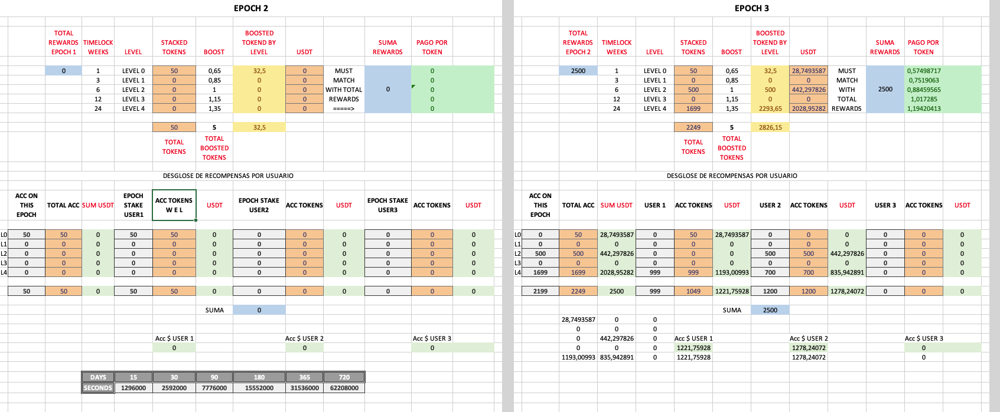
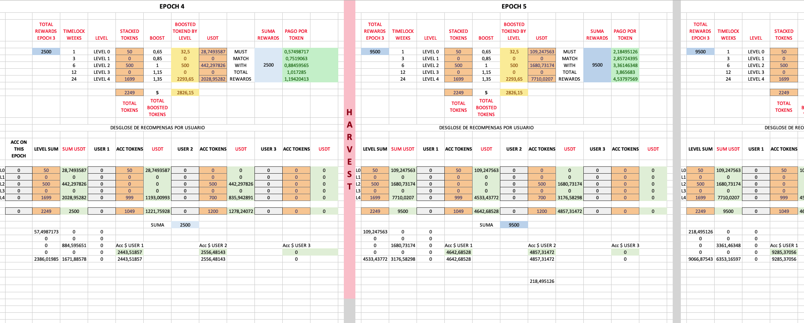
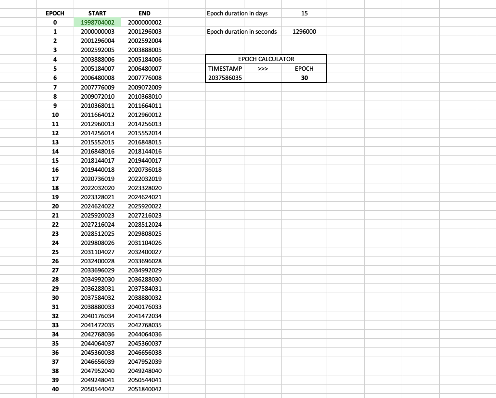

# Dexynth Multilevel Real Yield Staking

Original contract written at Dexynth (2023-2024). v2 and v2.1 are a later independent rework (Dec 2025 - Jan 2026) that replaces the loop-based reward logic with an O(1) reward accumulator.

**Status:** Proof of concept. Not audited. Not deployed.

## Overview

`DexynthStakingV2_1` ([src/DexynthStaking.sol](./src/DexynthStaking.sol)) lets users stake DEXY in one of several lock levels and earn a reward token (`REWARD_TOKEN`, fixed at deployment) that is streamed over time. Each level has a lock period and a reward multiplier. A level's share of the reward stream is proportional to its boosted stake (staked amount times multiplier), and inside a level rewards are split pro rata to the staked amount.

## Reward distribution model

- **Funding.** `addStakingReward(_amount, _duration)` transfers `_amount` of `REWARD_TOKEN` into the contract and sets a new stream: `rewardRate = (unstreamed remainder of the current period + _amount) / _duration` (integer division) and `rewardEndTime = now + _duration`. The function has no access control.
- **Streaming.** Rewards are released every second at `rewardRate` until `rewardEndTime`. They are not distributed per epoch.
- **Split between levels.** On every `stake`, `unstake`, `harvest` and `addStakingReward` the contract updates the pool: the rewards for the elapsed time are split across levels by `levelBoostedStake / totalBoostedStake`, where `levelBoostedStake = level.totalStaked * boostP / 1e10`, and added to the per-level accumulator `accRewardPerShare[level]` (1e18 precision).
- **Per stake.** A stake's pending reward is `stakedDexy * accRewardPerShare[level] / 1e18 - rewardDebt`. `rewardDebt` is set when the stake is created and updated on harvest.
- **Epochs.** `epochDuration` (at least one day) is set at deployment. Epochs are only used to compute two timestamps per stake:
  - `rewardStartTime`: the start of the next epoch. Before it the stake's rewards cannot be harvested and `pendingRewards` does not include them. The stake accrues rewards from the moment it is created, and what accrued before `rewardStartTime` becomes claimable at `rewardStartTime`.
  - `unlockTime = rewardStartTime + lockingPeriod`. The effective lock is the level's `lockingPeriod` plus the time left until the next epoch starts.
- **Claiming.** `harvest()` pays the pending rewards of all the caller's stakes that have reached `rewardStartTime`. `unstake(i)` returns the principal of stake `i` and pays that stake's pending rewards.
- **No stakers.** If `totalBoostedStake` is zero when the pool is updated, the elapsed time is skipped. The rewards streamed during that time are not assigned to anyone and stay in the contract.

## Staking levels

Levels are passed to the constructor as a `Level[]` array and cannot be changed afterwards. The constructor enforces:

- at least one level;
- `lockingPeriod` strictly increasing from one level to the next;
- `boostP` strictly increasing from one level to the next;
- the sum of all `boostP` values equals `numberOfLevels * 1e10`, so the average multiplier is 1.0x (`boostP = 1e10` means 1.0x).

No other bounds are checked (for example, there is no maximum lock period, and level 0 may have a `lockingPeriod` or `boostP` of 0). Stakes select a level with a `uint8` index.

**Example configuration.** This is the configuration used by the tests and by [script/DeployDexynthStaking.s.sol](./script/DeployDexynthStaking.s.sol), with a 15 day epoch (`1296000` seconds). It is an example, not a property of the contract.

| Level | `lockingPeriod` (s) | Lock | `boostP` | Multiplier |
|-------|---------------------|----------|-------------|------------|
| 0 | 2592000 | 30 days | 6500000000 | 0.65x |
| 1 | 7776000 | 90 days | 8500000000 | 0.85x |
| 2 | 15552000 | 180 days | 10000000000 | 1.00x |
| 3 | 31536000 | 365 days | 11500000000 | 1.15x |
| 4 | 62208000 | 720 days | 13500000000 | 1.35x |

## Tokens

- `DEXY` and `REWARD_TOKEN` are immutable addresses set at deployment. The deploy script reads the reward token from the `USDT_ADDRESS` environment variable.
- The contract never reads `decimals()` and does not assume a number of decimals for either token. Amounts are raw token units.
- The test tokens (`src/DEXY.sol`, `src/RewardToken.sol`) have 18 decimals. No test uses a reward token with fewer decimals.

## Core functions

```solidity
function stake(uint256 _amount, uint8 _level) external;
function unstake(uint64 _stakeIndex) external;
function harvest() external;
function addStakingReward(uint256 _amount, uint256 _duration) external;
function pendingRewards(address _user) external view returns (uint256);

// Owner only
function requestMigration(address _newContract) external;
function cancelMigration() external;
function executeMigration() external;
```

- `stake`: `_amount` in DEXY units, `_level` from 0 to `getNumberOfLevels() - 1`. Every call creates a new stake with its own index.
- `unstake`: `_stakeIndex` is the index of one of the caller's stakes. Reverts while the stake is locked.
- `harvest`: claims the rewards of all the caller's stakes. Reverts if the caller has nothing staked or nothing to claim.
- `addStakingReward`: `_amount` in `REWARD_TOKEN` units, `_duration` in seconds. Callable by any address.
- Views: `getLevels()`, `getNumberOfLevels()`, `getCurrentEpochIndex()`, `pendingRewards(address)`.

## Changelog

### v2.1 (Jan 2026): internal review

- **Invariant suite.** Added a stateful fuzzing suite (`test/invariant/`) based on a `Handler` contract.
- **`totalBoostedStake` rounding fix.** `totalBoostedStake` is now recomputed from the level totals on every stake and unstake instead of being updated incrementally (see Review notes).
- **Checks-Effects-Interactions.** `stake`, `unstake`, `addStakingReward` and `executeMigration` now update state before any token transfer. `harvest` already did.
- **Reentrancy guard.** `nonReentrant` was added to `executeMigration`. `stake`, `unstake`, `harvest` and `addStakingReward` already had it, so every function that transfers tokens is now guarded.
- **Precision constants.** Replaced the literals with `ACC_PRECISION` (1e18) and `BOOST_PRECISION` (1e10).
- **Indexed events.** The address parameters of the migration events are indexed.
- **Loops.** Array lengths are cached in the reward and level loops.

### v2 (Dec 2025): O(1) accumulator and cleanup

The loop-based reward logic, which iterated over epochs, was replaced with a MasterChef-style accumulator (`accRewardPerShare` per level). The gas cost of `stake`, `unstake` and `harvest` no longer depends on the number of elapsed epochs. It still depends on the number of levels, and `harvest` also depends on the number of stakes the caller has created (it loops over all of them, including unstaked ones).

- **Accumulator.** `testO1GasPerformance` checks that a `harvest` with one stake after 100 epochs (about 4.1 years with 15 day epochs) uses less than 250,000 gas.
- **Variable packing.** Timestamps use `uint40` and the epoch index `uint32`. `migrationRequestTime`, `lastRewardTime` and `rewardEndTime` share one storage slot.
- **Custom errors.** String revert messages were replaced with custom errors (for example `StakeStillLocked()`).
- **Explicit types.** `uint256` instead of `uint`.
- **Visibility.** `stake`, `unstake`, `harvest` and `addStakingReward` are `external`.
- **Unchecked loop increments.** Most loops increment their counter inside `unchecked`.
- **Reward token rename.** `USDT` was renamed to `REWARD_TOKEN`. The contract takes any ERC20 address, with the limitations listed below.
- **SafeCast.** OpenZeppelin `SafeCast` is used for the narrowing conversions of amounts, rewards, `epochDuration` and `rewardEndTime`. Casts of `block.timestamp`, the epoch index and the number of levels use plain casts.
- **NatSpec.** External and public functions, structs, events and the constructor have NatSpec. Custom errors and public state variables do not.
- **Migration timelock.** The instant `migrateContract()` was replaced with `requestMigration`, `cancelMigration` and `executeMigration` with a 30 day delay.
- **Immutable levels.** The fixed five-level array and its setter were replaced with a `Level[]` array set in the constructor.
- **Access control.** The custom `onlyGov` modifier was replaced with OpenZeppelin `onlyOwner`.
- **Cleanup.** Removed the `lastEpochHarvested` field, the `EpochClosed` event and the legacy per-epoch mappings.
- **Tooling.** Migrated from Hardhat to Foundry.

## Gas Performance (Optimized v2.1 - Jan 2026)

The figures in this table are carried over from the previous version of this README. They have not been re-measured in this revision, and the v1 column does not state the scenario it was measured in.

| Operation | Original Gas (v1) | V2 Gas (Dec) | **Hardened Gas (v2.1)** | Total Improvement (v1 → v2.1) |
| :--- | :--- | :--- | :--- | :--- |
| **Stake** | 260,117 | ~159,799 | **~167,017** | **~35.8%** 📉 |
| **Unstake** | > 3M+ (linear) | ~95,642 | **~95,083** | **> 96%** 📉 |
| **Harvest** | > 500k+ (linear) | ~166,370 | **~139,235** | **> 72%** 📉 |

> *Note: In v2.1, `stake` recomputes `totalBoostedStake` from the level totals instead of updating it incrementally (see Review notes).*

To measure gas yourself:

```bash
forge test --gas-report
```

## Testing

```bash
# Unit, fuzz and invariant tests
forge test

# Invariant tests only (stateful fuzzing)
forge test --match-contract Invariant
```

`forge test` runs 49 tests: 39 unit and fuzz tests in [test/DexynthStaking.t.sol](./test/DexynthStaking.t.sol) and 10 invariant functions in [test/invariant/Invariant.t.sol](./test/invariant/Invariant.t.sol). Fuzz tests use Foundry's default of 256 runs. The invariant settings in `foundry.toml` are `runs = 256`, `depth = 32` and `fail_on_revert = false`.

### Unit and fuzz tests

- **Staking:** staking at each level of the example configuration, balances, stake data, `rewardStartTime` and `unlockTime` alignment with the next epoch, zero amount and invalid level reverts.
- **Unstaking:** principal returned after the lock, `StakeStillLocked` before it, `AlreadyUnstaked` on a second call.
- **Rewards:** rewards are split by level multiplier (the level 4 staker receives more than 1.5x the level 0 staker for the same amount), `pendingRewards` is zero before `rewardStartTime`, harvesting pays rewards and `NoRewardsToHarvest` is raised when there is nothing to claim.
- **Migration:** timelock, cancellation, owner-only `requestMigration`, and `executeMigration` moving the full DEXY and reward token balances.
- **Gas:** `testO1GasPerformance` (see Changelog).

### Invariant tests

The handler has 10 actors and can call `stake`, `unstake`, `harvest`, `addStakingReward` (as the owner), `advanceTime` (1 hour to 90 days) and `advanceOneEpoch`. `unstake` and `harvest` return early without calling the contract when the selected stake is locked or there is nothing to claim.

| Invariant | What it checks |
|-----------|----------------|
| `invariant_dexyStakingSolvency` | The contract's DEXY balance is at least the handler's running total of staked DEXY. |
| `invariant_rewardsSolvency` | The handler's total of rewards harvested does not exceed its total of rewards added. |
| `invariant_levelTotalConsistency` | Each `level.totalStaked` equals the handler's per-level total, and their sum equals the global total. |
| `invariant_boostedStakeConsistency` | `totalBoostedStake` equals the sum of `totalStaked * boostP / 1e10` over all levels. |
| `invariant_userStakeConsistency` | Each actor's `totalStakedDexy` equals the sum of their open stakes. |
| `invariant_lastRewardTimeNotFuture` | `lastRewardTime <= block.timestamp`. |
| `invariant_unlockTimeAfterRewardStart` | `unlockTime >= rewardStartTime` for every stake. |
| `invariant_levelsImmutable` | The number of levels is still 5. |
| `invariant_boostOrderPreserved` | `boostP` and `lockingPeriod` are still strictly increasing. |
| `invariant_callSummary` | Prints the handler call counts. It asserts nothing. |

With the configuration above, the invariant suite found no violations across 256 runs of depth 32. No invariant checks that the reward token balance covers the rewards accrued to open stakes plus the rewards scheduled but not yet streamed.

## Security measures

- **Reentrancy:** OpenZeppelin `ReentrancyGuard` on every function that transfers tokens.
- **Token transfers:** OpenZeppelin `SafeERC20`.
- **Access control:** OpenZeppelin `Ownable` (single owner) on the three migration functions. `addStakingReward` is not restricted.
- **Migration delay:** 30 days between `requestMigration` and `executeMigration`.

## Original design model (Excel)

The original Dexynth design was modelled in a spreadsheet before it was implemented. The spreadsheet models the original epoch-based reward logic: the rewards of each epoch are split across levels by boosted stake, with a per-user breakdown for three users.

The spreadsheet file is not part of this repository (it is listed in `.gitignore`). No test in the current suite compares contract results against spreadsheet values. v2 streams rewards per second instead of per epoch, so the spreadsheet describes the v1 distribution, not the current one.






