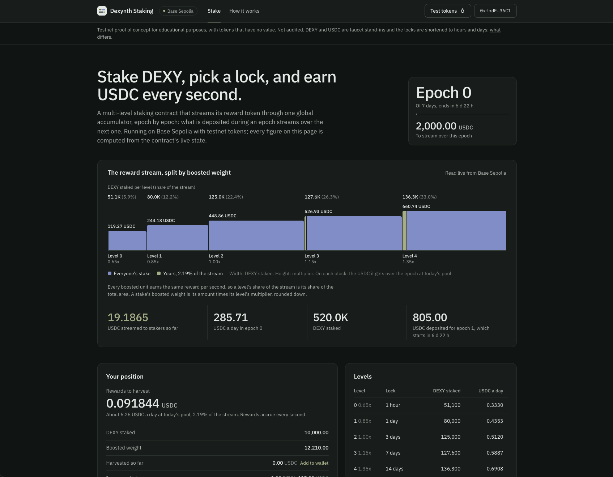

# Dexynth Multilevel Real Yield Staking

[](https://github.com/GushALKDev/evm-dexynth-multilevel-real-yield-staking/actions/workflows/ci.yml)
[](./LICENSE)
[](https://docs.soliditylang.org/)
[](https://getfoundry.sh/)

A multi-level staking contract that pays real yield: users lock DEXY in one of several levels, each with its own lock period and reward multiplier, and earn a reward token that anyone can deposit and the contract streams every second, epoch by epoch.

The original contract was written at Dexynth (2023-2024). v2 to v2.3 are a later independent rework (Dec 2025 - Oct 2026) that replaces the loop-based reward logic with a reward-per-share accumulator (one per level in v2 and v2.1, a single global one since v2.2). v2.3 was made together with the demo app, to improve the project's educational experience: see [what v2.3 adds](#what-v23-adds).

> **Proof of concept for educational purposes. Not audited and not deployed on any mainnet.**

**Demo app:** a web interface in [`app/`](./app/README.md) runs the staking contract on Base Sepolia with testnet tokens: stake, harvest, unstake and deposit rewards, with previews computed by the contract's own math.

**Live demo:** https://staking-poc.tesselium.com

[](https://staking-poc.tesselium.com)

---

## Highlights

- **Constant cost.** `stake`, `unstake` and `harvest` never loop over stakes, levels or epochs. `harvest` costs 160,239 gas after 1 epoch or after 100, with 1 stake or with 500; the original contract needed 22,492,295 gas to harvest after 100 epochs.
- **Steady epochs.** Anyone can deposit rewards, and a deposit streams over the next epoch to start, so the epoch already running keeps its rate and its end.
- **Exact with low-decimal reward tokens.** Rates and the accumulator are scaled by 1e36: with a 6-decimal reward token and a pool update every 12 seconds, a day of a 1,000 token, 15 day epoch pays exactly the expected 66,666,666 units.
- **Rounding favours the contract.** The invariant suites bound the reward balance from both sides: never below what is owed, never above it by more than the rounding dust.
- **Bounded owner powers.** The owner can only migrate. A migration waits 30 days, expires after a 7-day window and can only move rewards that are not streamed yet: never staked DEXY and never rewards already accrued to stakers.
- **Checked against the original.** A differential test shows v1 and v2.3 give every user the same share of what they pay, also when a user joins halfway.
- **Reviewed up to v2.2.** Three review rounds on v2.2; the tests of each finding were run against the code before its fix. The epoch funding of v2.3 came after them and has not been reviewed.

---

## Demo app

[app/](./app) runs this contract on Base Sepolia with testnet tokens. Every figure is read from the contract, and every
preview uses the contract's own rounding, checked to the wei against a local deployment.

- **What a visitor can do:** claim 10,000 DEXY and 500 USDC from the faucet, stake at any level, harvest, unstake, and
  deposit USDC as rewards to watch the next epoch's rate rise.
- **What differs from production:** 7-day epochs and locks of 1 hour to 14 days, so a stake can be unstaked an hour
  after it is made. The multipliers are the production ones.
- **Who funds the rewards:** a scheduled depositor on Cloudflare Workers plays the platform, depositing a day of yield
  every day, 500 to 2,000 USDC a week.

The testnet tooling and its tests live in [script/testnet/](./script/testnet). How the app works, how to run it and
how to deploy it: [app/README.md](./app/README.md).

---

## What v2.3 adds

v2.3 was built together with the demo app, to improve the project's educational experience: the contract becomes a
working model of how a platform pays out real yield to its stakers.

- **Rewards paced by epochs.** What is deposited during an epoch streams evenly over the next one, so stakers see a
  steady rate for a whole epoch and can watch the next epoch's rewards build up before it starts.
- **Deposits open to anyone.** Any account can deposit rewards with `addStakingReward(amount)`. The faucet hands out
  USDC as well as DEXY, so a visitor can make a deposit and see the next epoch's rate rise.
- **A scheduled start.** The deployment sets when epoch 0 starts, and what is deposited before it streams during
  epoch 0, so rewards flow from the first epoch on.
- **Locks counted from the stake.** A stake unlocks its level's lock after it was made, so a 1-hour lock ends exactly
  an hour later.
- **A depositor that plays the platform.** A Cloudflare Worker deposits a day of yield every day, 500 to 2,000 USDC a
  week, so the demo keeps paying rewards on its own.
- **An app that follows the epochs.** It shows the running epoch's rate, what is deposited for the next one and a
  preview of every deposit, all computed with the contract's own math.

Every interface change: [changes for users from v2.2 to v2.3](./docs/01-design.md#changes-for-users-from-v22-to-v23).

---

## How it works

`DexynthStakingV2_3` ([src/DexynthStaking.sol](./src/DexynthStaking.sol)) keeps one global accumulator of reward per boosted unit:

1. A stake's weight is its boosted amount, `amount * boostP / 1e10`, where `boostP` is the level's multiplier. Every boosted unit earns the same reward per second.
2. Anyone deposits rewards with `addStakingReward(amount)`. What is deposited during epoch N streams during epoch N + 1 at `queued / epochDuration` per second, and what is deposited before epoch 0 starts streams during epoch 0.
3. On every stake, unstake, harvest, deposit and migration the pool adds `elapsed * rewardRate / totalBoostedStake` to `accRewardPerBoostedShare`, moving to the next epoch first when one has started. Time with nobody staked goes to `unallocatedRewards` and is rolled into the next deposit.
4. Before a user's boosted balance changes, and on harvest, the contract settles `boostedBalance * (accumulator - snapshot) / 1e36` into the user's stored rewards, rounded down.

For example, with 7-day epochs from day 1: 10,000 tokens deposited on day 1 and 10,000 on day 5 stream together during days 8 to 14, and 5,000 deposited on day 10 stream during days 15 to 21. No deposit changes when or how fast the others are paid. A stake unlocks its level's `lockingPeriod` after it was made. Levels are fixed in the constructor (at most 10, lock and multiplier strictly increasing, average multiplier 1.0x). The configuration used by the tests and the deploy script, with 15-day epochs:

| Level | Lock | Multiplier |
|-------|------|------------|
| 0 | 30 days | 0.65x |
| 1 | 90 days | 0.85x |
| 2 | 180 days | 1.00x |
| 3 | 365 days | 1.15x |
| 4 | 720 days | 1.35x |

```solidity
function stake(uint256 _amount, uint8 _level) external;
function unstake(uint64 _stakeIndex) external;   // pays all accrued rewards; locked until unlockTime unless migrated
function harvest() external;
function pendingRewards(address _user) external view returns (uint256);
function addStakingReward(uint256 _amount) external;        // anyone; streams over the next epoch to start

// Owner only
function requestMigration(address _newContract) external;   // starts the 30-day delay
function cancelMigration() external;
function executeMigration() external;                       // 7-day window after the delay
```

The full accounting, the precision bounds, the token requirements, the migration rules and what changed for users from v2.1 and from v2.2: [Guide 1: Design](./docs/01-design.md).

---

## Gas: v1 against v2.3

Each call measured as its own transaction (`isolate = true`) under the same scenarios, from `FOUNDRY_PROFILE=gas forge test` and `python3 gas/gas_table.py`:

| Scenario | v1 | v2.3 | Reduction |
|----------|---:|-----:|----------:|
| `stake_first` | 251,367 | 173,984 | 30.8% |
| `harvest_after_1_epoch` | 586,466 | 160,239 | 72.7% |
| `harvest_after_100_epochs` | 22,492,295 | 160,239 | 99.3% |
| `unstake_after_100_epochs` | 22,518,395 | 207,058 | 99.1% |
| `harvest_levels_touched_5` | 725,766 | 160,239 | 77.9% |

In v1, `harvest` and `unstake` loop over every level for every epoch since the user's last harvest. CI regenerates the snapshots and fails if they change. All 16 scenarios and the methodology: [Guide 3: Testing and Gas](./docs/03-testing.md#gas).

---

## Security and testing

| Area | Result |
|------|--------|
| Tests | 136: unit, regression, bounds, edge cases, events, griefing, reentrancy, differential and invariants |
| Invariants | 5 properties (principal backing, reward liabilities, reward conservation, boosted accounting, migration) in 4 suites: normal operation and migration, each with an 18-decimal and a 6-decimal reward token, `fail_on_revert = true` |
| Exact expectations | In the unit, regression, bounds, edge case, event and griefing tests, reward checks compare a payout against the exact rational value: below it by at most a stated number of wei, never above |
| Coverage of `src/DexynthStaking.sol` | 100% lines (182/182), 99.12% statements (226/228, a constant the compiler folds), 100% branches (44/44), 100% functions (19/19) |
| Static analysis | Slither 0.11.6 and Aderyn 0.6.8: every finding triaged; the four Aderyn High instances are false positives (the contract never transfers ETH) |

Owner powers are limited to migrating what is not streamed yet; there is no pause and no emergency withdrawal. Deposits are open to anyone and only add to the next epoch, and dust or just-in-time stakes around a funded epoch have measured effects. Details: [Guide 2: Security](./docs/02-security.md). Every review finding, with its cause, fix, test and commit: [Guide 4: Review Notes and Changelog](./docs/04-review-notes.md).

---

## Getting started

Dependencies are git submodules pinned to release tags (forge-std v1.12.0, OpenZeppelin v4.9.3, also recorded in `foundry.lock`). Every figure in this README and the docs was measured with Foundry v1.7.1, solc 0.8.28 and `via_ir = true`.

```bash
git clone --recursive https://github.com/GushALKDev/evm-dexynth-multilevel-real-yield-staking.git
cd evm-dexynth-multilevel-real-yield-staking
forge build
forge test
```

```bash
forge test --match-path test/invariant/Invariant.t.sol          # invariant suites only
forge coverage --no-match-coverage "(bench|test|script)"        # coverage of src/
FOUNDRY_PROFILE=gas forge test && python3 gas/gas_table.py      # gas benchmarks, v1 against v2.3
```

---

## Repository layout

```
src/              the staking contract and the two test ERC20s
test/             unit, regression, bounds, edge case, griefing, reentrancy, differential and invariant tests
script/           the deploy script
script/testnet/   testnet faucet, demo deployment, reward top-up and their tests (FOUNDRY_PROFILE=testnet)
app/              the Base Sepolia demo app and its scheduled depositor (app/feeder/)
bench/            the frozen v1 contract used by the benchmarks and the differential test
gas/              gas benchmarks against v1
snapshots/        the gas snapshots CI regenerates and compares
docs/             the four guides and the demo app screenshot in this README (docs/images/)
images/           screenshots of the original spreadsheet model, used by the design guide
```

## Documentation

| Guide | Covers |
|-------|--------|
| [1. Design](./docs/01-design.md) | Reward accounting, precision and bounds, levels, tokens, functions, migration, the original spreadsheet model |
| [2. Security](./docs/02-security.md) | Owner powers, griefing and extraction measurements, limitations, security measures, static analysis |
| [3. Testing and Gas](./docs/03-testing.md) | Every test file, coverage, the invariant campaigns, the gas benchmarks against v1 |
| [4. Review Notes and Changelog](./docs/04-review-notes.md) | Every review finding with its cause, fix, test and commit; v2 to v2.3 changes |
| [bench/README.md](./bench/README.md) | The frozen v1 copy used by the benchmarks and the differential test |

## License

MIT, see [LICENSE](./LICENSE).

## Author

[@GushALKDev](https://github.com/GushALKDev), Gustavo Martín ([LinkedIn](https://www.linkedin.com/in/gustavomaral/)).
